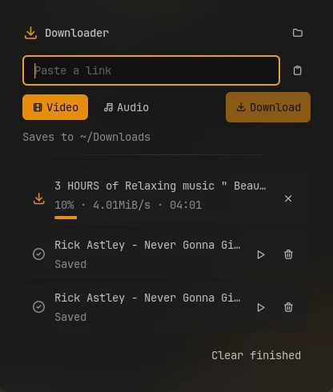
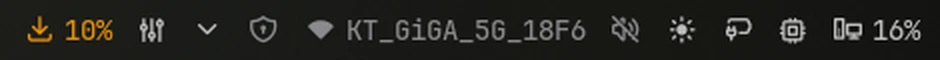

# Downloader

Download a video or its audio from a link, with yt-dlp, right from the bar. Paste a link,
pick video or audio, and follow the queue and progress in the bar.



## Plugin

| Field   | Value                                                    |
| ------- | -------------------------------------------------------- |
| ID      | `omerfuyar/downloader`                                   |
| Entries | Bar widget: `widget`; panel: `panel`; service: `service` |

## Supported sites

Downloader works with every site yt-dlp supports: more than a thousand, among them
YouTube, Instagram, TikTok, X (Twitter), Facebook, Reddit, Vimeo, Twitch, SoundCloud,
Bandcamp, Dailymotion and Bilibili. The full list is
[yt-dlp's supported sites](https://github.com/yt-dlp/yt-dlp/blob/master/supportedsites.md).

## Requirements

| Command    | Needed   | What for                                                                            |
| ---------- | -------- | ----------------------------------------------------------------------------------- |
| `yt-dlp`   | Required | Downloads from the sites it supports.                                               |
| `ffmpeg`   | Required | Joins video and audio, and converts audio.                                          |
| `sh`       | Required | Runs each download in the background. It comes with every Linux system.             |
| `kill`     | Required | Stops a download. It comes with every Linux system.                                 |
| `xdg-open` | Optional | Opens finished files and the download folder. Without it, those buttons are hidden. |

When `yt-dlp` or `ffmpeg` is missing, the panel offers to install both in a terminal.

## Usage

1. Add the **Downloader** widget to the bar and click it.
2. A link on the clipboard is filled in for you. Otherwise paste one, or press the
   clipboard button.
3. Pick **Video** or **Audio** and press **Download** or Enter.

Downloads run one at a time. While one runs, the bar shows its progress, and the tooltip
shows its name, speed and time left. The panel lists waiting and finished downloads; a
finished file opens with the play button, and a failed one can be tried again.



```sh
noctalia msg panel-toggle omerfuyar/downloader:panel
```

## Settings

| Setting          | Type     | Default       | Description                                                                                                                           |
| ---------------- | -------- | ------------- | ------------------------------------------------------------------------------------------------------------------------------------- |
| `folder`         | `folder` | `~/Downloads` | Where downloads are saved.                                                                                                            |
| `video_quality`  | `select` | `1080`        | Highest video resolution. A smaller video is used when the site has nothing this large.                                               |
| `audio_format`   | `select` | `mp3`         | File type for audio downloads. `best` (Original) keeps the site's format without converting.                                          |
| `notify`         | `bool`   | `true`        | Notify when a download finishes or fails.                                                                                             |
| `whole_playlist` | `bool`   | `false`       | Advanced. For a link to a video in a playlist, download the whole playlist. A link to the playlist itself always downloads all of it. |

## IPC

Queue a link as video or audio. Without a link, the clipboard's text is used, so a key
binding can download whatever link was just copied.

```sh
noctalia msg plugin omerfuyar/downloader:service all video "https://example.com/watch/123"
noctalia msg plugin omerfuyar/downloader:service all audio
```

## Notes

- Videos are saved as MP4 when the site's formats allow it, otherwise as MKV.
- The queue and yt-dlp's output for each download are kept in the plugin's data folder.
  A download keeps running when Noctalia reloads the plugin.
- Some sites block downloads or need a login; yt-dlp's error is shown on the failed item.
