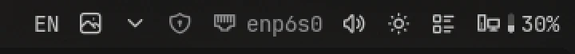
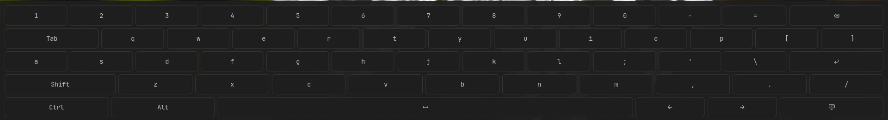

# Keyboard

Switch between every language you type in from one list: your keyboard layouts and fcitx5's
input methods, such as Hangul for Korean. Noctalia's own layout widget shows only the
compositor's layouts.

## Plugin

| Field   | Value                                                                  |
| ------- | ---------------------------------------------------------------------- |
| ID      | `omerfuyar/keyboard`                                                   |
| Entries | Bar widget: `widget`; panel: `panel`; service: `service`; layer: `osk` |

## Requirements

| Command         | Needed                              | What for                                                                                                          |
| --------------- | ----------------------------------- | ----------------------------------------------------------------------------------------------------------------- |
| `hyprctl`       | Required on Hyprland                | Reads the keyboard layouts and switches every keyboard between them, and adds the switch key.                     |
| `fcitx5-remote` | Required with fcitx5                | Reads and switches fcitx5's input method. Without fcitx5, the list holds only the layouts.                        |
| `gdbus`         | Required with fcitx5                | Reads fcitx5's input methods and their names. It comes with GLib.                                                 |
| `wtype`         | Required for the on-screen keyboard | Types each key of the on-screen keyboard into the window you type in. Without it, the panel offers to install it. |

## Usage

Add the **Keyboard** widget to the bar. It shows the language you type in, such as `EN`,
`TR` or `KO`.



- Right click or scroll on the widget to switch to the next language.
- Click it to see the whole list and pick one. Each keyboard layout of Hyprland's main
  keyboard is in it, and each fcitx5 input method that is more than a plain keyboard, such as
  Hangul, or that holds a layout Hyprland does not have.
- Picking a layout switches every keyboard to it, and puts fcitx5 back on plain typing.
  Picking an input method switches fcitx5 to it.
- Below the list, **Add a language** adds a keyboard layout or an fcitx5 input method from
  one picker, and ✕ removes one. Once you change the layouts here, Keyboard keeps its own list and
  sets it in Hyprland while Noctalia runs, also after Hyprland reloads its config; your
  Hyprland config is not changed. **Use Hyprland's layouts** gives the config's list back.
  Input methods are added to fcitx5's group through fcitx5, which saves them itself.



- Turn on **On-screen keyboard** in the panel for a compact key grid at the bottom of the
  screen, in your theme. It never takes the keyboard focus, so each key goes to the window you
  type in. It floats above the windows and never moves them. To move it, click its grip: the
  place it would take follows the pointer, and a click puts it there. The button at the left of
  its grip docks it again. It stays where you put it. Its ✕ hides it. The keys follow the active language: Turkish for TR,
  English otherwise. Shift, Ctrl and Alt hold for the next key. Korean is typed with a real
  keyboard: fcitx5 composes Hangul only from it.
- Set **Switch key** in the settings, such as `SUPER + Space`, to switch from the keyboard.
  Keyboard adds it to Hyprland while Noctalia runs and leaves your config alone; a key that
  is already bound stays as it is. Set **On-screen keyboard key** the same way to show and
  hide the on-screen keyboard. Each key needs a modifier, such as `SUPER`, unless it is not a
  letter or digit, such as `F12`.

```sh
noctalia msg panel-toggle omerfuyar/keyboard:panel
```

## Settings

| Setting      | Type     | Default | Description                                                                                          |
| ------------ | -------- | ------- | ---------------------------------------------------------------------------------------------------- |
| `keybind`    | `string` | `""`    | A key that switches to the next language, such as `SUPER + Space`. Empty adds no key.                |
| `osk_key`    | `string` | `""`    | A key that shows or hides the on-screen keyboard, such as `SUPER + K`. Empty adds no key.            |
| `osk_height` | `int`    | `220`   | Advanced. How tall the on-screen keyboard is, in pixels, from 140 to 400. It is three times as wide. |

## IPC

Switch to the next or previous language, or to one by its short name:

```sh
noctalia msg plugin omerfuyar/keyboard:service all next
noctalia msg plugin omerfuyar/keyboard:service all previous
noctalia msg plugin omerfuyar/keyboard:service all set TR
```

Add or remove a keyboard layout by its code, or an fcitx5 input method by its id, or give the
layouts back to Hyprland's config:

```sh
noctalia msg plugin omerfuyar/keyboard:service all add-layout de
noctalia msg plugin omerfuyar/keyboard:service all remove-layout de
noctalia msg plugin omerfuyar/keyboard:service all add-im mozc
noctalia msg plugin omerfuyar/keyboard:service all remove-im mozc
noctalia msg plugin omerfuyar/keyboard:service all reset-layouts
```

Show or hide the on-screen keyboard, or pick it up to move it, as its grip does:

```sh
noctalia msg plugin omerfuyar/keyboard:service all osk
noctalia msg plugin omerfuyar/keyboard:service all osk-move
```

## Notes

- Layouts come from Hyprland; on other compositors, only fcitx5's input methods are listed.
- The active language is read every second, so a switch made with fcitx5's own key shows too.
- The layouts Keyboard keeps are in `~/.local/state/noctalia/plugins/data/omerfuyar/keyboard/layouts.json`.
  Where the on-screen keyboard was put is in `osk.json` in the same folder.
