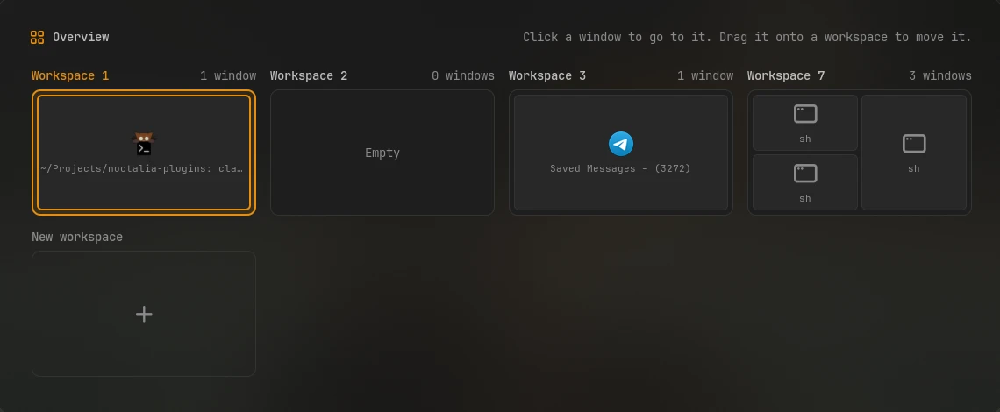

# Overview

See every workspace and its windows at once, laid out as they are tiled. Click a window
to go to it, click a workspace to switch to it, and drag a window onto another workspace
to move it there.



## Plugin

| Field   | Value                                                    |
| ------- | -------------------------------------------------------- |
| ID      | `omerfuyar/overview`                                     |
| Entries | Bar widget: `widget`; panel: `panel`; service: `service` |

## Requirements

- Hyprland. `hyprctl` reads the workspaces and windows and runs the moves. On other
  compositors, the panel says that Overview works on Hyprland.

## Usage

Add the **Overview** widget to the bar and click it, or bind a key to the panel:

```sh
noctalia msg panel-toggle omerfuyar/overview:panel
```


- Each workspace shows its tiled windows in their places, with the app's icon and title.
  Floating windows are small icons under them.
- The active workspace and the focused window have an accent border.
- Click a window to focus it, or a workspace's title to switch to it. The overview closes.
- Drag a window onto another workspace to move it there without leaving the overview.
  **New workspace** moves it to a new, empty one.
- Escape or a click outside closes the overview.

## Notes

- Windows are shown as icons, not live pictures of their content.
- Works with both Hyprland config formats, Lua and the older one.
- Based on ideas from Omarchy's Mirador plugin.
