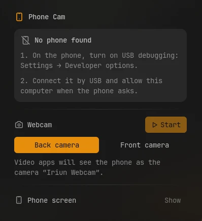

# Phone Cam

Use an Android phone as a webcam over USB, with its back or front camera, in any video
app. The same panel can also show the phone's screen in a window.



## Plugin

| Field | Value |
| --- | --- |
| ID | `omerfuyar/phone-cam` |
| Entries | Bar widget: `widget`; panel: `panel`; service: `service` |

## Requirements

- `scrcpy` sends the phone's camera or screen, and `adb` finds the phone. When either is
  missing, the panel offers to install both in a terminal.
- The webcam needs the `v4l2loopback` kernel module, which adds a virtual camera. When
  none is loaded, the panel offers to set it up once; this asks for your password and
  loads the module at every boot, with a camera named "Phone Cam".
- Android 12 or newer for the webcam; the screen works on older phones too.
- `sh` and `kill` run and stop scrcpy. They come with every Linux system.

## Usage

1. On the phone, turn on USB debugging in **Settings → Developer options**.
2. Connect it by USB and allow this computer when the phone asks.
3. Add the **Phone Cam** widget to the bar and click it. Pick the phone if more than one
   is connected.
4. Choose **Back camera** or **Front camera** and press **Start**. In your video app,
   pick the camera the panel names.


The widget turns into an accent-colored camera while the webcam runs. Right click it to
start or stop the webcam. **Phone screen → Show** opens the phone's screen in a window
that you can use with the mouse and keyboard.

```sh
noctalia msg panel-toggle omerfuyar/phone-cam:panel
```

## Settings

| Setting | Type | Default | Description |
| --- | --- | --- | --- |
| `quality` | `select` | `1080` | Size of the webcam picture: `720`, `1080` or `1440`. Larger needs a faster USB connection. |

## IPC

Start or stop the webcam, or the phone's screen, with the chosen phone:

```sh
noctalia msg plugin omerfuyar/phone-cam:service all webcam
noctalia msg plugin omerfuyar/phone-cam:service all mirror
```

## Notes

- The webcam keeps running when Noctalia reloads the plugin.
- scrcpy's error is shown in the panel when it stops on its own, for example when the
  phone is unplugged.
- For more phone features, such as wireless mirroring and KDE Connect actions, see the
  community plugin Phone Operate.
- Based on ideas from Omarchy's dori plugin.
