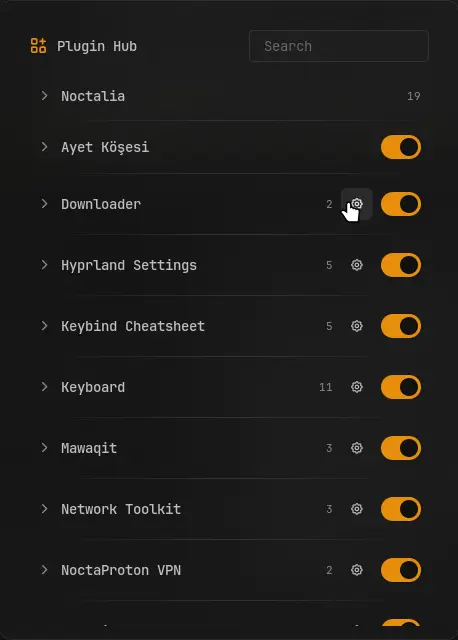

# Plugin Hub

Every plugin you use in one panel. Switch a plugin on or off, open its panels, run its
commands and give any of them a key, without keeping its widget in the bar. Noctalia's own
panels and commands of your own are in the same list, and in the launcher.



## Plugin

| Field           | Value                                                        |
| --------------- | ------------------------------------------------------------ |
| ID              | `omerfuyar/plugin-hub`                                       |
| Entries         | Panel: `panel`; service: `service`; launcher provider: `hub` |
| Launcher prefix | `/hub`                                                       |

## Requirements

| Command     | Needed               | What for                                                                                   |
| ----------- | -------------------- | ------------------------------------------------------------------------------------------ |
| `hyprctl`   | Required on Hyprland | Adds the keys you give actions. Without it, actions still run from the panel and launcher. |
| `sh`, `awk` | Required             | Read each plugin's manifest and README. They come with every Linux system.                 |
| `git`       | Required             | Reads a plugin that is off from its source. Noctalia itself needs it for plugins.          |

## Usage

Open the hub from Noctalia's launcher: type `/hub` and pick **Open Plugin Hub**, or open it
by IPC or a key:

```sh
noctalia msg panel-toggle omerfuyar/plugin-hub:panel
```

The panel lists Noctalia, each plugin you use, and your own commands. Search filters them
all.

- **Plugins.** Each enabled plugin is listed, and each one the hub saw enabled before, so a
  plugin you switch off here can be switched on again. The switch turns a plugin on or off,
  and the gear opens its settings.
- **Actions.** A plugin's actions are its panels, from its manifest, and the
  `noctalia msg` commands its README shows, named by the comment after them when there is
  one. Noctalia's are its launcher, control center tabs, wallpapers, clipboard, session
  menu, settings and do not disturb.
- ▶ runs an action. The key button gives it a key: type one such as `SUPER + K` and press
  Enter, or empty it to take the key away. A letter or digit needs a modifier. Keys are
  added to Hyprland while Noctalia runs; your Hyprland config is not changed. A key that
  something else already binds shows **Taken** and is left alone.
- **Your commands.** Add any `noctalia msg` command, such as `panel-toggle wallpaper` or
  `plugin noctalia/screen_recorder:service all toggle`, to run it and give it a key.

In the launcher, type `/hub` and part of a name to run any action. Results show their key.

Commands run without a shell: only letters, digits, spaces and `- _ . / : +` are taken, so a
README cannot make the hub run more than `noctalia msg`.

## IPC

Read the plugins again, such as after installing one:

```sh
noctalia msg plugin omerfuyar/plugin-hub:service all refresh
```

## Notes

- Keys, your commands and the plugins seen are in
  `~/.local/state/noctalia/plugins/data/omerfuyar/plugin-hub/hub.json`.
- The list is read again every 30 seconds and when the panel opens.
