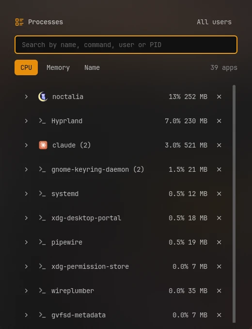

# Process Manager

Find a running app and end it, or force it to end when it does not stop. Apps are grouped
by name, with the CPU and memory they use right now.



## Plugin

| Field   | Value                                                    |
| ------- | -------------------------------------------------------- |
| ID      | `omerfuyar/process-manager`                              |
| Entries | Bar widget: `widget`; panel: `panel`; service: `service` |

## Requirements

| Command   | Needed   | What for                                                                                                                |
| --------- | -------- | ----------------------------------------------------------------------------------------------------------------------- |
| `ps`      | Required | Lists the processes, with their owner and command line.                                                                 |
| `kill`    | Required | Ends a process.                                                                                                         |
| `sh`      | Required | Reads every process in one go, with `awk` and `cat`. They come with every Linux system.                                 |
| `getconf` | Required | Finds the clock rate and page size, to turn the kernel's numbers into CPU and memory. It comes with every Linux system. |
| `pkexec`  | Optional | Ends another user's process, after asking for an administrator's password. Without it, those cannot be ended.           |

## Usage

Add the **Process Manager** widget to the bar and click it.


- Search by name, command line, user or process ID, and sort by CPU, memory or name.
- Each row is an app with how many processes it has. Open it to see each process.
- **✕** asks the app or process to end, so it can save and close. When it is still running
  3 seconds later, **Force end** stops it at once, without saving.
- A process that belongs to another user, such as root, shows **End as admin**, which
  asks for a password.
- Only your own processes show, unless **All users** is on.
- A process waiting on a disk or device, or one that already ended and waits for its
  parent, says so: neither can be ended until that changes.

```sh
noctalia msg panel-toggle omerfuyar/process-manager:panel
```

## Notes

- Processes are read only while the panel is open, every 2 seconds, from `/proc` and `ps`.
- CPU is the use since the last read, where 100% is one core, as `top` shows it.
- System totals are not shown here: Noctalia's system monitor shows them.
