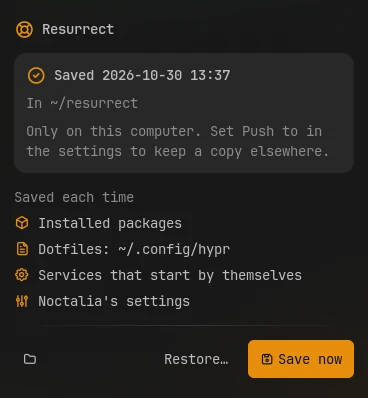

# Resurrect

Save your system's setup to a git repository: the packages you installed, your dotfiles,
the services that start by themselves and Noctalia's settings. Share the dotfiles between
your devices, and on a new install, bring it all back with one script.



## Plugin

| Field   | Value                                                    |
| ------- | -------------------------------------------------------- |
| ID      | `omerfuyar/resurrect`                                    |
| Entries | Bar widget: `widget`; panel: `panel`; service: `service` |

## Requirements

| Command                                | Needed   | What for                                                                                                   |
| -------------------------------------- | -------- | ---------------------------------------------------------------------------------------------------------- |
| `git`                                  | Required | Keeps each save as a commit, and pushes it when a remote is set. Without it, the panel says so.            |
| `sh`                                   | Required | Runs the plugin's save script. It comes with every Linux system.                                           |
| `systemctl`                            | Optional | Lists and restores the services that start by themselves. Without it, services are not saved.              |
| `xdg-open`                             | Optional | Opens the repository folder. Without it, that button is hidden.                                            |
| `pacman`, `apt-mark`, `dnf`, `flatpak` | Optional | List installed packages; each one the system has is used. Without any, no packages are saved.              |
| `paru` or `yay`                        | Optional | Restore AUR packages. Without them, the AUR list stays in `packages/aur.txt`.                              |
| `gitleaks`                             | Optional | Checks each save for passwords, tokens and keys before it is committed. Without it, saves are not checked. |
| `hyprctl`                              | Optional | Checks Hyprland's config after shared files come in. Without it, they are not checked.                     |
| `python3`                              | Optional | Shares Noctalia's settings one setting at a time. Without it, they stay on each device.                    |

## Usage

Add the **Resurrect** widget to the bar. The setup is saved once a day, and when you
press **Save now** in the panel.


- The panel shows when the setup was last saved, where, and how many packages, services,
  Noctalia plugins, dotfiles and steps of your own the last save held.
- Choose the dotfiles in the settings. The default, `~/.config`, saves your whole config
  folder; list files elsewhere, such as `~/.icons/default/index.theme`, beside it. Links
  are followed, here and in Noctalia's config, so files kept elsewhere, as with GNU Stow,
  are saved themselves.
- Inside a folder, a save leaves out what is not settings: caches, logs and crash reports,
  the data of browsers and Electron apps such as Brave or VS Code, nested git folders,
  binary files and files over 1 MB. A file you list by name is always saved, such as
  `~/.config/Code/User/settings.json`.
- List what else to skip in **Leave out**, such as `~/.config/gh/hosts.yml`, which holds
  a token, or `~/.config/kdeconnect`, which holds this device's key.
- When the dotfiles still add up to more than 50 MB, or a file cannot be read, nothing is
  saved, and the panel names the folder.
- To keep a copy off this device, set **Push to** to a private git repository.
- **Restore…** opens a terminal that asks before each step.

On a new install, before anything else:

```sh
git clone <your repository> ~/resurrect
~/resurrect/restore.sh
```

The script asks which device's save to use when there is no save of this device, then
installs the saved packages, puts back the dotfiles and Noctalia's settings, turns on the
saved Noctalia plugins and services, and runs your own steps. It asks before each of
these, and copies any file it would replace to `~/.local/state/resurrect/backup-<date>`
first.

```sh
noctalia msg panel-toggle omerfuyar/resurrect:panel
```

### Sharing between devices

With **Share between devices** on, as it is by default, devices that push to the same
repository share their setup. Each save, and each start of Noctalia, also takes in what the
other devices changed:

- A dotfile that only another device changed is put in place here. The file it replaces
  goes to `~/.local/state/resurrect/backup-<date>` first.
- A dotfile that only this device changed reaches the others on their next save. A file
  deleted on one device is deleted on the others, into the same backup. When a device
  deletes more than half of the shared files at once, the others keep theirs and share
  them again.
- A dotfile changed on two devices is left as it is on both. The panel lists it, with
  **Keep mine** and **Take theirs**.
- When files that came in give Hyprland config errors, they go back, and the panel lists
  them as held back until another device changes them again.

List the files that differ by hardware in **Only this device**, such as a monitor layout or
GPU variables. They are saved, but not shared.

Noctalia's config folder is shared like the dotfiles. All settings changed in its settings
window are shared one setting at a time, such as the bar, the theme, the wallpaper and
idle: a setting only another device changed is taken, and when two devices changed one,
each keeps its own. A setting shared for the first time takes the value of the device that
shared it first. Plugins turned on or off on one device are turned on or off on the others.
Only settings tied to the hardware stay on each device: brightness, battery, widgets placed
on a monitor, and Resurrect's **Share between devices** and **Only this device**.

The panel also lists the packages your other devices have and this one does not.
**Install…** opens a terminal that installs them all. **Not here** leaves a package off
this device, in `devices/<name>/skip.txt`; **Leave all out** does it for the whole list.

### The repository

| Path                      | What it holds                                                                                                                                  |
| ------------------------- | ---------------------------------------------------------------------------------------------------------------------------------------------- |
| `devices/<name>/`         | What Resurrect saved on the device with that hostname. One repository can hold several devices.                                                |
| `devices/<name>/skip.txt` | Packages other devices have that this device leaves out, one per line. The panel's **Not here** adds to it.                                    |
| `shared/`                 | The dotfiles and Noctalia's settings shared between devices, when sharing is on.                                                               |
| `packages/exclude.txt`    | Optional, yours. Package names left out of every save: one regular expression per line, for the whole name, such as `linux.*` or `.*nvidia.*`. |
| `packages/extra.txt`      | Optional, yours. Packages installed on restore besides the saved ones, one per line, such as ones pacman counts as dependencies.               |
| `.gitleaksignore`         | Optional, yours. Findings of the secret check that may be committed.                                                                           |
| `hooks/save/`             | Your own steps for each save. Resurrect never changes this folder.                                                                             |
| `hooks/restore/`          | Your own steps for restoring. Resurrect never changes this folder.                                                                             |
| `restore.sh`              | The restore script, updated on each save.                                                                                                      |

Anything else in the repository is yours too: Resurrect only writes `devices/<name>/` of
the device it runs on, `shared/` and `restore.sh`.

### Secrets

When `gitleaks` is installed, each save is checked before it is committed. If something
looks like a password, token or key, nothing is committed, and the panel names the file.
Take the file out of the dotfiles, or allow the finding in `.gitleaksignore`.

### Your own steps

Put an executable script in `hooks/save/` to run it on every save, and one in
`hooks/restore/` to offer it on restore. They run in name order, from the repository's
folder, with these variables:

| Variable           | Value                                                  |
| ------------------ | ------------------------------------------------------ |
| `RESURRECT_REPO`   | The repository's folder.                               |
| `RESURRECT_DEVICE` | The hostname of the device whose save it is.           |
| `RESURRECT_DIR`    | That device's folder in the repository, for its files. |

Whatever a save step writes into the repository is committed with the save. A save step
that fails stops the save, and the panel shows it. For example, to also save a database:

```sh
#!/bin/sh
# hooks/save/20-notes
cp ~/.local/share/notes/notes.db "$RESURRECT_DIR/notes.db"
```

```sh
#!/bin/sh
# hooks/restore/20-notes
mkdir -p ~/.local/share/notes
cp "$RESURRECT_DIR/notes.db" ~/.local/share/notes/notes.db
```

The panel's hooks button opens the folder and creates it when it is missing.

## Settings

| Setting        | Type          | Default         | Description                                                                |
| -------------- | ------------- | --------------- | -------------------------------------------------------------------------- |
| `folder`       | `folder`      | `~/resurrect`   | The git repository the setup is saved in. It is created when missing.      |
| `remote`       | `string`      | `""`            | A git remote to push each save to. Empty keeps the saves on this device.   |
| `files`        | `string_list` | `["~/.config"]` | Files and folders in the home folder to save.                              |
| `leave_out`    | `string_list` | `[]`            | Files and folders inside the dotfiles not to save.                         |
| `share`        | `bool`        | `true`          | Share the dotfiles with the other devices that push to the same remote.    |
| `device_files` | `string_list` | `[]`            | Shown when `share` is on. Files and folders saved but kept on this device. |
| `daily`        | `bool`        | `true`          | Save once a day while Noctalia runs.                                       |
| `packages`     | `bool`        | `true`          | Advanced. Save the list of installed packages.                             |
| `services`     | `bool`        | `true`          | Advanced. Save which services start by themselves.                         |
| `noctalia`     | `bool`        | `true`          | Advanced. Save Noctalia's config and settings.                             |

## IPC

Save now:

```sh
noctalia msg plugin omerfuyar/resurrect:service all save
```

## Notes

- Do not add files with passwords, tokens or keys to the dotfiles when the repository
  is pushed, and push only to a private repository.
- Only packages installed on purpose are saved, not their dependencies.
- Each save is a git commit, so older setups stay in the repository's history.
- With **Push to** set, a device without the repository folder clones it on its first
  save, so all devices share one history.
- Several devices can push to one repository: before pushing, a save is put on top of the
  other devices' saves. A file both changed, such as a step in `hooks/`, keeps the version
  of the device that saves last.
