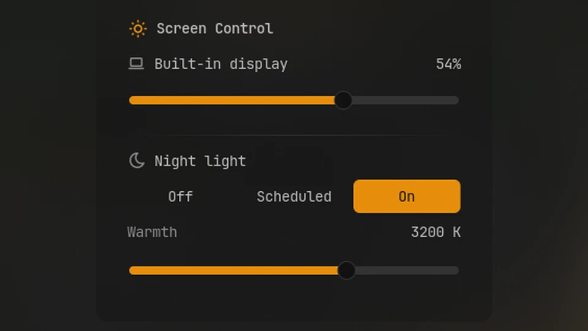

# Screen Control

One bar item for everything about your screens: the brightness of each monitor, dimming
further than the lowest brightness, and night light. Each workspace can also keep its own
dimming.



## Plugin

| Field | Value |
| --- | --- |
| ID | `omerfuyar/screen-control` |
| Entries | Bar widget: `widget`; panel: `panel`; service: `service`; layer: `dim` |

## Requirements

- `noctalia` sets brightness and night light; they are Noctalia's own.
- `ddcutil` shows the brightness of external monitors. Noctalia uses it too, when
  **Brightness → ddcutil** is on in its settings. Without it, external monitors can still
  be dimmed.
- `hyprctl` is needed only to dim each workspace on its own, which works on Hyprland.

## Usage

Add the **Screen Control** widget to the bar. It shows a sun, or a moon while night light
is on, and turns the accent color while its monitor is dimmed.

- Scroll on the widget to change the brightness of the monitor the bar is on. Below the
  lowest brightness, scrolling down dims the screen further.
- Click it to open the panel. Each monitor has one slider: its right part is the
  brightness, and its left part dims below the lowest brightness ("Dim 30%").
- Under **Night light**, pick **Off**, **Scheduled** (sunset to sunrise, as set in
  Noctalia) or **On**, and set the warmth.

```sh
noctalia msg panel-toggle omerfuyar/screen-control:panel
```

## Settings

| Setting | Type | Default | Description |
| --- | --- | --- | --- |
| `max_dim` | `int` | `95` | How dark the screen can get below its lowest brightness, in percent. |
| `per_workspace` | `bool` | `false` | Each workspace keeps its own dimming. Needs Hyprland. |

## IPC

Move the focused monitor up or down the same scale as the slider, by 5% or by the given
percent. Bound to the brightness keys, this dims past the lowest brightness.

```sh
noctalia msg plugin omerfuyar/screen-control:service all up
noctalia msg plugin omerfuyar/screen-control:service all down 10
```

## Notes

- Dimming draws a black layer over the screen; it does not change the backlight. Clicks
  pass through it.
- Night light is changed through Noctalia's settings, so it stays as you set it after a
  restart. Noctalia's own night light widget switches a temporary state that plugins
  cannot read, so the panel may not match it until night light is changed here or in
  Noctalia's settings.
- The lowest brightness is Noctalia's **Minimum brightness**, but never below 1%, since
  some backlights turn off at 0.
- Based on ideas from Omarchy's screen-comfort plugin.
