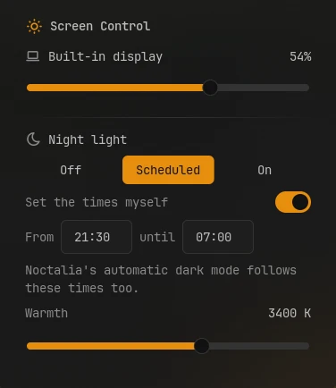
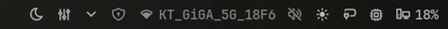

# Screen Control

One bar item for everything about your screens: the brightness of each monitor, dimming
further than the lowest brightness, night light with its schedule, and caffeine. Each
workspace can also keep its own dimming.



## Plugin

| Field   | Value                                                                  |
| ------- | ---------------------------------------------------------------------- |
| ID      | `omerfuyar/screen-control`                                             |
| Entries | Bar widget: `widget`; panel: `panel`; service: `service`; layer: `dim` |

## Requirements

| Command           | Needed               | What for                                                                                                                                                  |
| ----------------- | -------------------- | --------------------------------------------------------------------------------------------------------------------------------------------------------- |
| `noctalia`        | Required             | Sets brightness, night light and caffeine, which are Noctalia's own.                                                                                      |
| `hyprsunset`      | Required on Hyprland | Dims below the lowest brightness by lowering the gamma, on Hyprland. The plugin starts it when it is not running. Without it, a black layer dims instead. |
| `hyprctl`         | Required on Hyprland | Talks to hyprsunset, and finds the workspace on each monitor. Without it, a black layer dims, and each workspace cannot keep its own dimming.             |
| `ddcutil`         | Optional             | Reads the brightness of external monitors; Noctalia uses it too, when **Brightness → ddcutil** is on. Without it, external monitors can still be dimmed.  |
| `systemd-inhibit` | Required             | Reads whether Noctalia's caffeine is on, so the panel matches Noctalia's own menu. Without it, the panel shows caffeine as it last set it.                |

## Usage

Add the **Screen Control** widget to the bar. It shows a sun, or a moon while night light
is on, and turns the accent color while its monitor is dimmed.



- Right click the widget to switch night light on, or off when it is on or scheduled.
- Scroll on the widget to change the brightness of the monitor the bar is on. Scrolling
  down stops at the lowest brightness.
- Click it to open the panel. Each monitor has a brightness slider. Once it is at the
  lowest brightness, an **Extra dim** slider shows under it, to dim further ("Dim 30%").
  Raising the brightness ends the extra dim. A monitor without brightness control has only
  the extra dim slider.
- Under **Night light**, pick **Off**, **Scheduled** or **On**, and set the warmth.
  **Scheduled** runs from sunset to sunrise where Noctalia's location is; turn on
  **Set the times myself** to type a start and end time instead, such as `21:30` and
  `07:00`.
- **Caffeine** keeps the screen on and stops it from locking. It is Noctalia's own caffeine, so it matches Noctalia's menu.

```sh
noctalia msg panel-toggle omerfuyar/screen-control:panel
```

## Settings

| Setting         | Type     | Default | Description                                                                                                                                                                 |
| --------------- | -------- | ------- | --------------------------------------------------------------------------------------------------------------------------------------------------------------------------- |
| `max_dim`       | `int`    | `75`    | How dark the screens can get below their lowest brightness, in percent.                                                                                                     |
| `dim_method`    | `select` | `gamma` | How the screens get darker below their lowest brightness: `gamma`, with hyprsunset, or `overlay`, a black layer. Gamma falls back to the layer where hyprsunset is missing. |
| `per_workspace` | `bool`   | `false` | Each workspace keeps its own dimming. Needs Hyprland.                                                                                                                       |
| `step_dims`     | `bool`   | `false` | Advanced. Scrolling on the widget and the brightness keys go on past the lowest brightness into extra dim.                                                                  |

## IPC

Move the focused monitor's brightness up or down, by 5% or by the given percent. Down stops
at the lowest brightness, unless **Scroll into extra dim** is on; up ends extra dim first.

```sh
noctalia msg plugin omerfuyar/screen-control:service all up
noctalia msg plugin omerfuyar/screen-control:service all down 10
```

Set night light, or switch caffeine on and off:

```sh
noctalia msg plugin omerfuyar/screen-control:service all night scheduled
noctalia msg plugin omerfuyar/screen-control:service all caffeine
```

## Notes

- Gamma dimming is one level for all screens, since hyprsunset sets every screen alike.
  It does not show in screenshots or recordings. When the plugin stops, gamma goes back
  to full.
- Night light and its times are Noctalia's own settings, so they stay after a restart.
  Custom times also set when Noctalia's automatic dark mode switches. Noctalia's own
  night light widget switches a temporary state that plugins cannot read, so the panel
  may not match it until night light is changed here or in Noctalia's settings.
- The black layer dims each screen on its own, but also darkens screenshots.
- The lowest brightness is Noctalia's **Minimum brightness**, but never below 1%, since
  some backlights turn off at 0.
