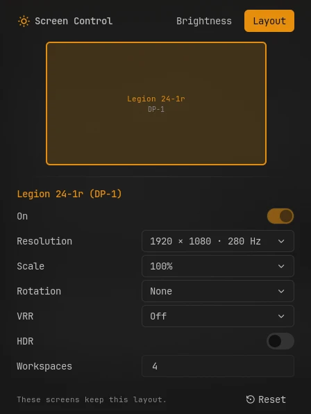

# Screen Control

One bar item for everything about your screens: the brightness of each monitor, dimming
further than the lowest brightness, night light with its schedule, and caffeine. Each
workspace can also keep its own dimming. On Hyprland, it also arranges your screens by
dragging, sets each one's resolution, refresh rate, scale, rotation, VRR and HDR, mirrors
one or turns it off, and chooses which workspaces open on which screen. Each set of
connected screens remembers its own layout.


## Plugin

| Field   | Value                                                                             |
| ------- | --------------------------------------------------------------------------------- |
| ID      | `omerfuyar/screen-control`                                                        |
| Entries | Bar widget: `widget`; panel: `panel`; services: `service`, `layout`; layer: `dim` |

## Requirements

| Command           | Needed               | What for                                                                                                                                                                                                                |
| ----------------- | -------------------- | ----------------------------------------------------------------------------------------------------------------------------------------------------------------------------------------------------------------------- |
| `noctalia`        | Required             | Sets brightness, night light and caffeine, which are Noctalia's own.                                                                                                                                                    |
| `hyprsunset`      | Required on Hyprland | Dims below the lowest brightness by lowering the gamma, on Hyprland. The plugin starts it when it is not running. Without it, a black layer dims instead.                                                               |
| `hyprctl`         | Required on Hyprland | Talks to hyprsunset, finds the workspace on each monitor, and reads and applies the screens' layout. Without it, a black layer dims, each workspace cannot keep its own dimming, and the **Layout** view shows nothing. |
| `ddcutil`         | Optional             | Reads the brightness of external monitors; Noctalia uses it too, when **Brightness → ddcutil** is on. Without it, external monitors can still be dimmed.                                                                |
| `systemd-inhibit` | Required             | Reads whether Noctalia's caffeine is on, so the panel matches Noctalia's own menu. Without it, the panel shows caffeine as it last set it.                                                                              |

## Usage

Add the **Screen Control** widget to the bar. It shows a sun, or a moon while night light
is on, and turns the accent color while its monitor is dimmed.


- Right click the widget to switch night light on, or off when it is on or scheduled.
- Scroll on the widget to change the brightness of the monitor the bar is on. Scrolling
  down stops at the lowest brightness.
- Click it to open the panel. Its **Brightness** view has a brightness slider for each monitor. Once it is at the
  lowest brightness, an **Extra dim** slider shows under it, to dim further ("Dim 30%").
  Raising the brightness ends the extra dim. A monitor without brightness control has only
  the extra dim slider.
- Under **Night light**, pick **Off**, **Scheduled** or **On**, and set the warmth.
  **Scheduled** runs from sunset to sunrise where Noctalia's location is; turn on
  **Set the times myself** to type a start and end time instead, such as `21:30` and
  `07:00`.
- **Caffeine** keeps the screen on and stops it from locking. It is Noctalia's own caffeine, so it matches Noctalia's menu.

```sh
noctalia msg panel-toggle omerfuyar/screen-control:panel
```

### Layout

Pick **Layout** at the top of the panel. It works on Hyprland.



- It shows your screens to scale, as they are arranged. Drag a screen onto an edge of
  another to put it there: left, right, above or below, lined up at the start, the middle
  or the end of that edge.
- Click a screen to change it:
  - **Resolution and refresh rate**, from the modes the screen reports.
  - **Scale**, from the scales that give whole pixels.
  - **Rotation**.
  - **VRR**: off, on, or only for full-screen apps, on screens that support it.
  - **HDR**, on screens that support it, with the brightness of normal content while it
    is on.
  - **Mirror**, to show another screen's picture on this one.
  - **Workspaces** that open on this screen, such as `1-5`.
  - **On**, to turn the screen off and on. The last screen that is on stays on.
- Changes apply at once. A change that can leave a screen dark, a new resolution or
  refresh rate, VRR, HDR, mirroring or turning a screen off, asks **Keep this layout?**
  for 15 seconds, and the widget shows a clock. **Keep** keeps it; **Undo**, or doing
  nothing, puts the screens back as they were.
- **Reset** forgets the layout of the screens connected now and puts them back as they
  were before your first change, so Hyprland's own settings apply again.

Screen Control knows a screen by its make, model and serial, never by the port it is
plugged into. Each set of connected screens, such as the laptop alone or the laptop with a
monitor, keeps its own layout. A set of screens it has not seen keeps Hyprland's own
layout until you change it.

The layout applies while Noctalia runs: when Noctalia starts, when screens are plugged in
or out, and after Hyprland reloads its config. Screen Control never writes Hyprland's
config. Before Noctalia starts, and once the plugin is turned off or removed, Hyprland's
own settings apply. Hyprland cannot take a workspace rule back while it runs, so a
workspace taken off a screen keeps opening there until Hyprland reloads its config, unless
your config names a screen for it. Leave other display tools, such as Hyprland Settings'
Displays page or kanshi, without rules for the same screens, or they change them back.

## Settings

| Setting         | Type          | Default | Description                                                                                                                                                                 |
| --------------- | ------------- | ------- | --------------------------------------------------------------------------------------------------------------------------------------------------------------------------- |
| `max_dim`       | `int`         | `75`    | How dark the screens can get below their lowest brightness, in percent.                                                                                                     |
| `dim_method`    | `select`      | `gamma` | How the screens get darker below their lowest brightness: `gamma`, with hyprsunset, or `overlay`, a black layer. Gamma falls back to the layer where hyprsunset is missing. |
| `per_workspace` | `bool`        | `false` | Each workspace keeps its own dimming. Needs Hyprland.                                                                                                                       |
| `step_dims`     | `bool`        | `false` | Advanced. Scrolling on the widget and the brightness keys go on past the lowest brightness into extra dim.                                                                  |
| `skip_monitors` | `string_list` | `[]`    | Advanced. Monitors to leave out, by connector, such as `HDMI-A-1`, or part of their name. For a monitor whose brightness control misbehaves.                                |
| `keep_seconds`  | `int`         | `15`    | Advanced. How long **Keep this layout?** waits before it puts the screens back, in seconds, from 5 to 60.                                                                   |

## IPC

Move the focused monitor's brightness up or down, by 5% or by the given percent. Down stops
at the lowest brightness, unless **Scroll into extra dim** is on; up ends extra dim first.

```sh
noctalia msg plugin omerfuyar/screen-control:service all up
noctalia msg plugin omerfuyar/screen-control:service all down 10
```

Set night light, or switch caffeine on and off:

```sh
noctalia msg plugin omerfuyar/screen-control:service all night scheduled
noctalia msg plugin omerfuyar/screen-control:service all caffeine
```

Apply the remembered layout again, or answer **Keep this layout?**:

```sh
noctalia msg plugin omerfuyar/screen-control:layout all apply
noctalia msg plugin omerfuyar/screen-control:layout all keep
noctalia msg plugin omerfuyar/screen-control:layout all undo
```

## Notes

- Gamma dimming is one level for all screens, since hyprsunset sets every screen alike.
  It does not show in screenshots or recordings. When the plugin stops, gamma goes back
  to full.
- Night light and its times are Noctalia's own settings, so they stay after a restart.
  Custom times also set when Noctalia's automatic dark mode switches. Noctalia's own
  night light widget switches a temporary state that plugins cannot read, so the panel
  may not match it until night light is changed here or in Noctalia's settings.
- The black layer dims each screen on its own, but also darkens screenshots.
- The lowest brightness is Noctalia's **Minimum brightness**, but never below 1%, since
  some backlights turn off at 0.
