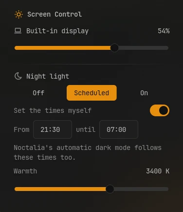
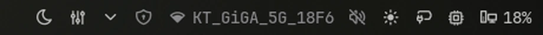

# Screen Control

One bar item for everything about your screens: the brightness of each monitor, dimming
further than the lowest brightness, and night light with its schedule. Each workspace can
also keep its own dimming.

todo also add caffeine functionality !!!



## Plugin

| Field   | Value                                                                  |
| ------- | ---------------------------------------------------------------------- |
| ID      | `omerfuyar/screen-control`                                             |
| Entries | Bar widget: `widget`; panel: `panel`; service: `service`; layer: `dim` |

## Requirements

- `noctalia` sets brightness and night light; they are Noctalia's own.
- `hyprsunset` and `hyprctl` dim below the lowest brightness on Hyprland, by lowering the
  screens' gamma. The plugin starts hyprsunset itself when it is not running. Without
  them, dimming draws a black layer over each screen instead.
- `ddcutil` shows the brightness of external monitors. Noctalia uses it too, when
  **Brightness → ddcutil** is on in its settings. Without it, external monitors can still
  be dimmed.
- `hyprctl` is also needed to dim each workspace on its own.

## Usage

Add the **Screen Control** widget to the bar. It shows a sun, or a moon while night light
is on, and turns the accent color while its monitor is dimmed.



- Scroll on the widget to change the brightness of the monitor the bar is on. Below the
  lowest brightness, scrolling down dims further.
- Click it to open the panel. Each monitor has one slider: its right part is the
  brightness, and its left part dims below the lowest brightness ("Dim 30%").
- Under **Night light**, pick **Off**, **Scheduled** or **On**, and set the warmth.
  **Scheduled** runs from sunset to sunrise where Noctalia's location is; turn on
  **Set the times myself** to type a start and end time instead, such as `21:30` and
  `07:00`.

```sh
noctalia msg panel-toggle omerfuyar/screen-control:panel
```

## Settings

| Setting         | Type   | Default | Description                                                             |
| --------------- | ------ | ------- | ----------------------------------------------------------------------- |
| `max_dim`       | `int`  | `75`    | How dark the screens can get below their lowest brightness, in percent. |
| `per_workspace` | `bool` | `false` | Each workspace keeps its own dimming. Needs Hyprland.                   |

## IPC

Move the focused monitor up or down the same scale as the slider, by 5% or by the given
percent. Bound to the brightness keys, this dims past the lowest brightness.

```sh
noctalia msg plugin omerfuyar/screen-control:service all up
noctalia msg plugin omerfuyar/screen-control:service all down 10
```

## Notes

- Gamma dimming is one level for all screens, since hyprsunset sets every screen alike.
  It does not show in screenshots or recordings. When the plugin stops, gamma goes back
  to full.
- Night light and its times are Noctalia's own settings, so they stay after a restart.
  Custom times also set when Noctalia's automatic dark mode switches. Noctalia's own
  night light widget switches a temporary state that plugins cannot read, so the panel
  may not match it until night light is changed here or in Noctalia's settings.
- The lowest brightness is Noctalia's **Minimum brightness**, but never below 1%, since
  some backlights turn off at 0.
- Based on ideas from Omarchy's screen-comfort plugin.
